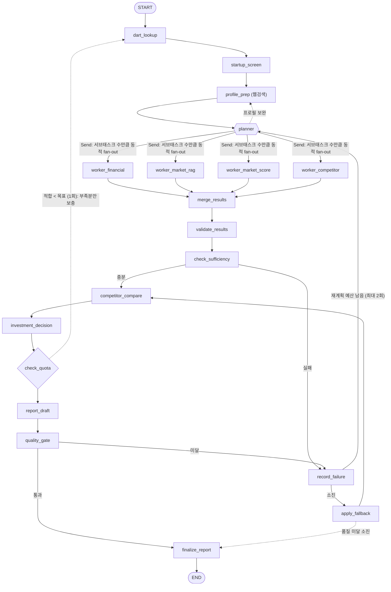

# AI Startup Investment Evaluation Agent (Orchestrator-Workers)

본 프로젝트는 AI 데이터센터 전력·에너지 인프라 스타트업을 재무(VBM)·시장성·경쟁 관점에서 평가하는 시스템을
**Orchestrator-Workers 패턴** 기반으로 설계/개발한 프로젝트입니다. (기존 순차 파이프라인은 `app_legacy.py`로 보존)

## Overview

- Objective : 하나의 기업을 재무·시장성·경쟁 관점으로 나누어 병렬 조사하고, 근거가 충분한 기업만 투자 적합 여부를 판단해 보고서로 작성
- Pattern : **Orchestrator-Workers** — 관점(재무/시장 자료/시장성 채점/경쟁사)이 서로 독립적이라 실행 전에 계획해 병렬로 나눌 수 있고,
  관점마다 근거 충분성이 달라 부족한 관점만 다시 조사하는 구조가 필요해 선택. (Agent-as-Tool, Swarm은 고려하지 않음)
- 동적 처리 : 고정 순서·고정 개수와 다른 점
  - 워커 수가 계획 이후에 결정됩니다. 서브태스크(기업 × 관점)를 State에 저장하고 `Send`로 fan-out 합니다. (예: 최초 20개 → 재계획 6개 → 2개)
  - 검증·근거 충분성·품질 평가에서 실패한 (기업, 관점)만 재계획합니다. 이미 유효한 결과는 다시 돌리지 않고 재사용합니다.
  - 프로필 근거가 약한 기업은 '프로필 추가 보완'을 먼저 거치고, 재계획 루프는 **최대 2회**입니다.
  - 일부 워커 실패는 `재시도 → (소진 시) 제외 또는 경고 후 계속`으로 처리합니다.

## Selected Technologies

- 통괄 에이전트 : **LangGraph Orchestrator-Workers** — 서브태스크(기업 × 관점)를 State에 저장하고 `Send`로 병렬 fan-out, 실패한 관점만 재계획(최대 2회)
  - 선정 이유: 재무·시장 자료·시장성 채점·경쟁사 관점이 서로 독립적이라 병렬로 나눌 수 있고, 관점마다 근거 충분성이 달라 부족한 관점만 다시 조사해야 하기 때문.

- 평가 대상: **DART, RAG, 웹검색** : 
  - DART 선정 이유 : 외부감사 대상 비상장 기업은 감사보고서로 재무를 공시하므로 투자 단계 정보가 없는 기업도 같은 기준(VBM)으로 비교할 수 있기 때문
  - RAG 선정 이유 : 시장 규모·성장률은 자주 바뀌지 않는 문서형 자료라 출처를 붙여 추출하기 적합하고, 한국어·영문 문서가 섞여 있어 다국어 임베딩을 사용.
  - 웹검색 선정 이유 : 기업별 사업 내용과 최신 시장·정책 정보는 문서풀과 DART에 없기 때문. 사업 설명·분야는 DART에 없으므로 웹검색 결과에서만 확정(공통 기업 프로필)

## Features

- DART API 기반 기업·재무 정보 추출 : 기업개황·재무제표 API로 기업 정보와 재무를 가져오고, 공시 값이 비면 감사보고서 PDF를 내려받아 재무 항목을 추출
  - 기업 수집 : 고유번호(`corpCode`) 전체에서 이름에 에너지 관련 키워드(에너지·배터리·수소·솔라·신재생·전력·ESS·태양광)가 들어간 법인을 무작위로 섞어 조회하고, 기업개황(`company`)으로 비상장(E)·코넥스(N), 설립 2015년 이후만 남긴 뒤 자산총계 500억 원 이하만 통과(자산 50억 미만 Seed~Pre-A, 200억 미만 Series A~B, 500억 이하 Series C로 추정)
  - 재무제표 수집 : 재무제표 API(`fnlttSinglAcntAll`)를 먼저 조회하고, 값이 비면 공시 목록(`list`)에서 감사보고서 접수번호를 찾아 PDF를 내려받아 pdfplumber(실패 시 pypdf)로 텍스트를 뽑아, 당기·전기 행을 규칙(정규식)으로 파싱해 14개 재무 항목을 연도별로 구성
- PDF 자료 기반 정보 추출 : 시장조사 PDF/논문 18건을 ChromaDB에 임베딩해 시장 규모·성장성·수요 근거를 추출, 관련 자료가 없으면 웹 보완
  - RAG : 발전(태양광·풍력·태양열), 저장·전력망(이차전지·ESS), 데이터센터 인프라(냉각·UPS·전력 수급), 수소·산업가스·핵융합을 다루는 문서를 Semantic Chunking(문장 임베딩 유사도 0.65 미만에서 분할, 200~1200자) 후 bge-m3로 임베딩해 ChromaDB에 저장하고, 질의마다 Top-4 청크 중 cosine 거리 0.4 이내만 채택해 출처(파일·쪽)와 함께 추출
  - 웹 보완 : 채택된 청크가 없으면 Research Nester 시장 보고서로 한정해 검색(Tavily, 실패 시 DuckDuckGo)
- 웹검색 기반 공통 기업 프로필 : Serper 검색 결과 스니펫에 있는 내용만으로 사업 설명·분야를 확정하고 출처를 기록. 같은 Serper 검색을 시장성 질문 10개의 근거 수집과 경쟁사 출처 확인에도 사용
- 외부 시장성 채점 : 질문 10개 × 웹 근거 → 100점(적합 하한 50점), VBM(ROIC–WACC, 수익성·안정성·성장성)과 결합해 판단
- 확증 편향 방지 전략
  - 경쟁사는 모델 제안을 검색으로 확인해 **출처가 있는 타사만** 근거로 인정(기업 자신의 자료·일반 명사는 제외)
  - 시장성 채점 근거의 도메인 다양성·저품질(유튜브·블로그) 비중을 충분성 규칙으로 검사
  - 보고서 품질 평가에서 단일 도메인 편중, 저품질 출처 인용 비중, 한계·위험(반대 근거) 서술 여부를 검사
- 보고서 품질 평가 : 보고서 생성 후 Groundedness / 중립성 / 편향 통제를 판정하고 미달 시 재계획 Loop (규칙 기반, 아래 참조)
- 보고서 : 지난 보고서 구성(SUMMARY → 종합 분석 → 시장·경쟁 → 투자 판단·리스크 → REFERENCE, 5쪽) 그대로 PDF 생성

## Tech Stack

- Framework : LangGraph (Orchestrator-Workers, `Send` fan-out, SQLite 체크포인터)
- LLM/Generator : GPT-4o-mini (스크리닝·프로필·경쟁사 제안), GPT-4.1-mini (시장 요약)
- LLM/Judge : GPT-4o-mini (시장성 질문 10항 채점). 보고서 품질 평가는 규칙 기반(LLM 심사 없음)
- Retrieval : ChromaDB(cosine) — Hit Rate@4 **0.981**, MRR@10 **0.915** (질의 54개, `docs/retrieval_eval.md`)
- Embedding : BAAI/bge-m3

## Agents

기존 7단계 워크플로우(기업 개수 설정 → DART 검색 → 스타트업 검증 → 시장성 조사 → 경쟁사 조사 → 투자 판단 → 리포트 작성)를
**에이전트 4개 + 전체 통괄(LangGraph 노드)** 로 나누어 5명이 각각 하나씩 맡아 개발했고, 이를 Orchestrator-Workers로 재구성했습니다.

- 전체 통괄 (LangGraph) : `orchestrator/` — Orchestrator(`planner`: 서브태스크 계획·재계획), 동적 fan-out 라우팅, 결과 병합·검증·근거 충분성, 실패 기록·fallback, 품질 평가(`quality_gate`)
- Agent 1 · 1~3단계 DART 검색 + 스타트업 검증 : `agents/dart.py`, `agents/startup_screen.py` → 노드 `dart_lookup`, `startup_screen`, `profile_prep`(웹검색 공통 기업 프로필)
- Agent 2 · 4단계 시장성 조사(RAG) : `agents/market_agent.py`, `agents/rag.py`, `agents/embed.py` → 워커 `worker_market_rag`
- Agent 3 · 5·6단계 경쟁사 조사 + 투자 판단 : `agents/compitition.py`와, 기능별로 분리한 `agents/judge.py` → 워커 `worker_competitor`, `worker_financial`(`financial_vbm.py`), `worker_market_score`(`market_scoring.py`), 노드 `competitor_compare`, `investment_decision`
- Agent 4 · 7단계 리포트 작성 : `agents/report_prep.py`, `agents/report.py` → 노드 `report_draft`(초안), `finalize_report`(PDF)

Orchestrator-Workers 구성에서는 위 에이전트의 기능을 노드 하나당 기능 하나로 나누었습니다. (노드 = 기능 하나)

- Workers : `worker_financial`(VBM 재무 계산) · `worker_market_rag`(시장 규모·성장성 근거) · `worker_market_score`(시장성 질문 10개 채점) · `worker_competitor`(경쟁사 제안 + 검색 출처 확인)
- Synthesizer : `merge_results`(워커 결과 집계) → `validate_results` → `check_sufficiency` → `competitor_compare` → `investment_decision`(적합/부적합) → `check_quota`(적합이 목표에 모자라면 DART 검색부터 다시 해 부족분만 보충, 최대 1회) → `report_draft`
- 조정 : `record_failure`, `apply_fallback`, `finalize_report`, `save_unresolved`

## State Schema

(상세: `orchestrator/state.py`, `ORCHESTRATOR.md`)

- 제어 vs 페이로드 분리 : State는 계획·상태·요약·ref(URI)만 가집니다. 프로필·워커 결과 원본·보고서 본문은 `outputs/runs/{run_id}/` 저장소에 두고 `report_uri` 등 참조만 보관합니다.
- 관측성 위치 : 결정·계획·실패·품질 이력은 State가 아니라 외부 이벤트 로그(`events.jsonl`)에 `{trace_id, node, event, reason, ts}`로 남깁니다. State에는 `status`, `step_count`, `error_count`, `last_error{node,type,message,ts}`, `errors[{agent,error,ts}]` 같은 Error-aware 최소 필드만 둡니다.
- 지속성 비용 : 체크포인트에 실리는 State는 요약 크기이며 이력성 데이터를 State에 쌓지 않아 무한 증식하지 않습니다.
- 상관 : `run_id`(= trace_id)를 State·저장 경로·이벤트 로그·LangSmith metadata에 공통으로 사용합니다.
- 재개/복구 : `status`·`node_status`·`step_count`·`replan_count`·결과 ref가 State에 있고, `--checkpoint sqlite` + `--resume RUN_ID`로 이어서 실행합니다.
- 동시 처리 : 워커가 동시에 쓰는 `results`(회차 기준 최신 우선 병합), `errors`, `error_count`, `last_error`, `node_status`, `step_count`에 리듀서를 지정했습니다.
- 종료 보장 : `replan_count ≤ max_replans(2)`, `step_count < max_steps`를 `record_failure`가 확인하고, `recursion_limit`은 최후 안전장치입니다.

## Architecture



## Directory Structure

```
├── data/                  # 시장조사 PDF(for_embed), 문서 메타, 검색 평가 QA(eval)
├── agents/                # 기능별 에이전트 (DART, 시장 RAG, 재무, 시장성 채점, 경쟁사, 투자 판단, 보고서)
├── orchestrator/          # 조정 계층: state, planner, 라우팅, 노드(nodes/), 관측성, 규칙, 그래프 조립
├── prompts/               # 프롬프트 템플릿
├── scripts/               # eval_retrieval.py (Hit Rate / MRR)
├── tests/                 # 테스트 + 실제 결과 fixture
├── outputs/               # 실행 결과 (runs/{실행 시각 YYYYMMDD_HHMMSS}/: 보고서, 이벤트 로그, 워커 결과)
├── docs/                  # 검색 평가, 보고서 계약, 요구사항 점검
├── chroma_db/             # 시장 자료 벡터 DB (없으면 data/for_embed 로 자동 생성)
├── assets/                # 보고서 PDF 폰트
├── config.py, state.py    # 기존 파이프라인 설정·State (agents/ 가 사용)
├── app.py                 # 실행 스크립트 (Orchestrator-Workers)
├── app_legacy.py          # 기존 순차 파이프라인
├── ORCHESTRATOR.md        # 조정 계층 설계 상세
├── requirements.txt       # 의존성
├── .env.example           # 필요한 환경변수 이름 (값은 .env 에)
└── README.md
```

## Usage

```bash
cp .env.example .env                    # DART_API_KEY, OPENAI_API_KEY, SERPER_API_KEY, (선택) LANGCHAIN_* 입력
pip install -r requirements.txt

python app.py                                        # 실행: DART·검색·LLM 실제 호출, LangSmith 트레이싱은 .env 설정을 따름
python app.py --company-count 3                      # 평가 기업 수 지정
python app.py --company-count 3 --no-trace
python app.py --max-replans 2                        # 재계획 루프 상한 (기본 2)
python -m pytest tests -q                            # 테스트 (가짜 응답기 사용, API 키 불필요)
python scripts/eval_retrieval.py                     # Hit Rate / MRR 재측정
```

## Contributors

- 신종민 : 전체 통괄(LangGraph 노드 구성·그래프 연결), 스타트업 검증
- 이우성 : DART 검색·재무 수집, PDF 전처리
- 손민재 : 시장성 조사(RAG), 기업 정보 추출
- 권태현 : 경쟁사 조사, 투자 판단(외부 시장성·VBM)
- 김가빈 : 리포트 작성(산출물 통합, 투자 보고서)
